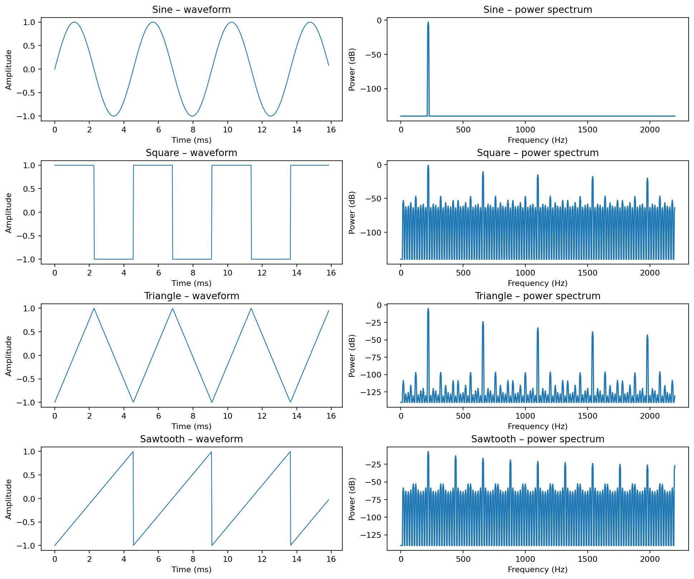

# Digital Audio Synthesizer

A complete Python implementation of a MIDI-driven audio synthesizer and modular effects rack, developed for the Signals and Systems course at Sharif University of Technology.

**Project team:** Farzan Aghaei, Sanaz Mazrae

## Implementation

The executed [Jupyter notebook](Digital_Audio_Synthesizer.ipynb) contains the complete implementation and quantitative demonstrations:

- Four oscillators: sine, square, triangle and sawtooth; multi-oscillator detuning and resonant low-pass filtering.
- AHDSR envelope with separate note-on and note-off stages.
- Tempo-aware MIDI event decoding and audio synthesis using MIDI pitch, velocity and note duration, with polyphonic mixing and an alternative MIDI loader/synthesizer interface.
- Class-based effect rack with adjustable gains, wet/dry blending, bypass and sequential processing.
- Hard clipping, soft clipping, variable saturation, compressor, fixed delay and LFO delay, phaser and LFO phaser, flanger and LFO flanger, chorus and LFO chorus, digital reverberation, convolution reverb (four impulse responses), voltage-controlled filter, multiband vocoder and pitch shifter.
- Reproducible WAV exports, waveform and spectral analyses, and a metrics table.

For design equations, selected parameters, performance measurements and figures, see the [technical report](Digital_Audio_Synthesizer_Report.pdf).

## Results

The supplied MIDI file yields **11 note events** and two **4.17 s** synthesized signals (sine and alternative detuned triangle voices) including release. The project provides **34 WAV recordings**, including individual oscillator and filter demonstrations, all effect variants, four convolution reverb examples, the complete **48.04 s vocoder** recording and a six-effect combined rack. The measured RMS, peak and duration of each recording are available in [`outputs/metrics.csv`](outputs/metrics.csv).



## Run locally

Use Python 3.10 or later, from the repository root:

```bash
python -m pip install -r requirements.txt
jupyter lab Digital_Audio_Synthesizer.ipynb
```

Run all cells in order. The notebook reads the included source recordings and MIDI file from `assets/` and saves numerical outputs to `outputs/` and figures to `figures/`. The saved notebook already contains the principal figures and experiment outputs, so it can also be inspected without executing it.

## Repository structure

```text
Digital_Audio_Synthesizer.ipynb   Complete executable notebook
Digital_Audio_Synthesizer_Report.pdf   Detailed technical report
README.md                         Overview and execution instructions
requirements.txt                  Python dependencies
assets/                            Supplied MIDI, audio and four room responses
outputs/                           All generated WAV files and metrics.csv
figures/                           Measured signal plots
```
